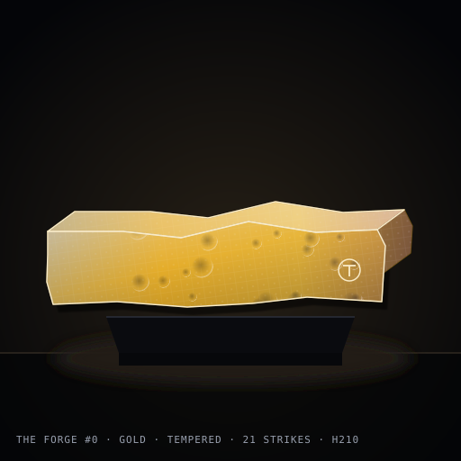

# THE FORGE

**333 bars of metal, fully on-chain on Base. Strike to shape, temper to lock, fuse to alloy, neglect to cool. No artist, only the hammer.**

Preview: **https://3esign.github.io/the-forge/**



> The Forge never sleeps. Each bar comes out of the furnace soft, glowing, with a crystal lattice only it carries. What it becomes depends on the hand that holds it. Strike it and it remembers. Leave it and it cools. Bring two to the anvil and they become something neither was alone. There is no artist here. There is only the hammer, the heat, and whoever shows up to work.

## The art is the history

Every image is rendered by `ForgeArt.sol` from contract state, returned as a data URI by `tokenURI()`. No server, no IPFS, nothing to go dark.

| State | What you see |
|---|---|
| lattice (fixed at mint) | crystal grid angle and cell size, metal family, casting roughness of the outline |
| strikes | each strike nudges one vertex of the outline and leaves a peening dent; every two strikes thin and lengthen the bar |
| hardness | reveals the lattice (opacity) and thickens the rim |
| heat | core glow and floor reflection, fading over 3 days; sparks fly off the last strike while fresh |
| cold (shaped, neglected) | lustre gone, ash settles |
| tempered | oxide colours, bright locked rim, hallmark |
| alloy (fused) | damascus waves, denser with generation |
| scars (transfers) | hairline cracks at the edge |

Five metal families from the lattice: iron 50%, copper 25%, silver 15%, gold 8%, meteor 2% (olivine specks). A sixth, **damascus**, cannot be minted, only forged by fusing two different families.

Curated states rendered by the real renderer are in `docs/gallery/`, regenerated with:

```
forge script script/Gallery.s.sol
```

## Mechanics

| Call | Effect | Fee |
|---|---|---|
| `mint()` | cast a raw bar at the current tranche price (33 / 100 / 100 / 100 at 0.003 / 0.005 / 0.008 / 0.012 ETH), 5 per wallet | tranche |
| `strike(id)` | +1 strike, +10 hardness, reheats, outline changes; one per bar per 10 min; 21st strike **tempers** (locks) | 0.0003 ETH |
| `fuse(a, b)` | burn two shaped/tempered bars you own, mint one alloy: hardness = max + 50, generation + 1, same family or damascus | 0.002 ETH |
| `temper()` | anyone; cools every shaped bar untouched for 3 days: −20 hardness, −1 strike, may fall back to raw; 50 bars per call | gas |
| `quench(id)` | reheat without striking | 0.0009 ETH |
| `harvest()` | anyone; splits balance 70 / 30 to the two treasuries | gas |

Alloys and tempered bars are immune to cooling. `MAX_SUPPLY` counts casts, not living bars, so fusing only ever shrinks supply.

Standards: ERC-721, ERC-2981 (5%), ERC-4906 (metadata refresh on every change), ERC-7572 `contractURI()`. The owner can only mint the 8-bar artist reserve; ownership is renounced after setup. No pause, no upgrade, no admin.

## Working it from X

Any agent wallet can call the public functions. With [@bankrbot](https://x.com/bankrbot) (MFA enabled):

```
@bankrbot mint from contract 0x… on Base
@bankrbot call strike(ID) on 0x… with 0.0003 ETH
@bankrbot call fuse(A, B) on 0x… with 0.002 ETH
@bankrbot create a daily automation: call temper() on 0x…
```

Bankr reads `currentPrice()` and sends the exact value.

## Build and test

```
forge build --sizes
forge test
forge script script/Gallery.s.sol        # regenerate docs/gallery
```

47 tests: tranches, per-wallet cap, reserve, sold-out counting casts not living bars, strike cooldown and lock, temper threshold, fuse burn accounting and family rule, generation depth, cooling with cursor bound and gas bound, quench, heat curve, fee split, royalty, scars, metadata, and fuzzing of the renderer (never reverts, always valid SVG under 24 KB, outline stays on canvas).

## Deploy

```
PRIVATE_KEY=… TREASURY=0x… SECONDARY_TREASURY=0x… \
forge script script/Deploy.s.sol --rpc-url base_sepolia --broadcast --verify
```

Deploys `ForgeRenderer` then `TheForge` wired to it as an immutable. After deploy, `docs/data/contract.json` takes `{ "address": "0x…", "chainId": 8453 }` and the preview page reads bars live.

## Marketplaces

Data-URI metadata and ERC-2981 mean OpenSea, Magic Eden, Rarible and Zora index the collection automatically once it exists on Base. `contractURI()` supplies the collection name, description, image and link.

## Layout

```
src/TheForge.sol        the collection
src/ForgeArt.sol        the renderer, pure
src/ForgeRenderer.sol   renderer wrapper deployed once, wired as immutable
test/TheForge.t.sol     47 tests
script/Deploy.s.sol     deploy
script/Gallery.s.sol    render curated states into docs/
docs/                   GitHub Pages preview
```

Made by Semir Poturak / Svemir. MIT.
